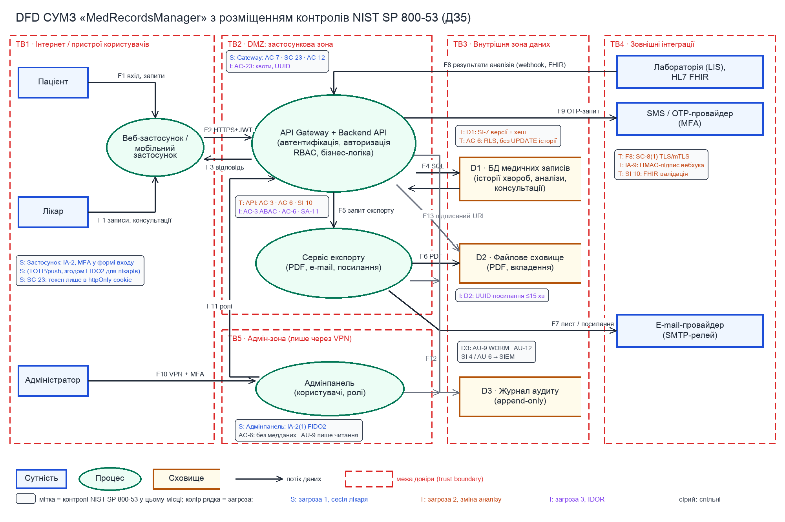

# ДЗ5. Поглиблений аналіз СУМЗ: від загроз до контролів в архітектурі

| Поле | Значення |
|---|---|
| Дисципліна | Advanced Security Architecture and Engineering (Master of Science: Cyber Security, GoIT Neoversity) |
| Тема | 5. Вибір заходів контролю: фреймворки, SAMM і мапування |
| Студент | Фарід Джафарлі |
| Система | «MedRecordsManager» (СУМЗ), та сама система, що в ДЗ2 (STRIDE, DFD) і ДЗ3 (SQUARE, вимоги SR-01…SR-04) |
| Ланцюг аналізу | STRIDE → MITRE ATT&CK Enterprise → NIST SP 800-53 Rev. 5 (з опорою на мапування CTID Mappings Explorer) → D3FEND (опційно) → розміщення на DFD |

## Контекст

У ДЗ2 я побудував для СУМЗ DFD (межі довіри TB1-TB5, потоки F1-F13) і зробив STRIDE-аналіз API, бази медичних записів і сервісу експорту. У ДЗ3 ці результати стали вимогами SR-01…SR-04. Тут я беру три найкритичніші загрози, описую, як їх реалізує атакувальник (техніки MITRE ATT&CK), добираю контролі NIST SP 800-53 і показую, де в архітектурі СУМЗ працює кожен контроль і що з цього можна зробити вже в MVP.

Контролі я відбирав так: кожен має запобігати техніці, виявляти її або зменшувати наслідки. Контроль без прив’язки до конкретної техніки й конкретного компонента я не включав. Інакше документ перетворився б на перелік з каталогу, не пов’язаний з архітектурою захисту.

## 1-2. Три загрози СУМЗ і їхні категорії STRIDE

| № | Загроза | Компонент DFD | STRIDE | Звʼязок з ДЗ2 / ДЗ3 |
|---|---|---|---|---|
| 1 | Захоплення сесії лікаря через фішинг з AiTM-проксі та повторне використання токена в API | Веб/мобільний застосунок → API Gateway + Backend API (F1, F2); IdP / MFA (F9) | S | ДЗ2: топ-3 (DREAD 7,4); ДЗ3: загроза T3 → вимога SR-02 |
| 2 | Несанкціонована зміна результату аналізу в БД або дорогою від лабораторії | Backend API → D1 (F4); вебхук лабораторії LIS → API (F8, межа TB4 → TB2) | T | ДЗ2: топ-2; ДЗ3: загроза T2 → вимога SR-03 |
| 3 | IDOR / BOLA: читання чужих історій хвороб підміною ідентифікатора в запиті до API | Backend API (F2/F3) → D1 (F4) | I | ДЗ2: топ-1 (DREAD 9,0); ДЗ3: загроза T1 → вимога SR-01 |

### Загроза 1. Захоплення сесії лікаря (фішинг з AiTM-проксі, повторне використання токена)

| Поле | Опис |
|---|---|
| STRIDE | S (Spoofing) |
| Компонент | Вхід у веб/мобільний застосунок (F1), видача токенів IdP і перевірка токена на API Gateway (F2); SMS/OTP-провайдер (F9). |
| Як реалізується | Лікар отримує лист «Підтвердіть обліковий запис у кабінеті лікаря» з посиланням на проксі-сторінку. Проксі в реальному часі передає пароль і SMS-код у справжню систему, а собі залишає сесійний cookie і refresh-токен. Далі зловмисник з власного пристрою викликає GET /api/patients/{id}/records від імені лікаря. |
| Чому важлива саме тут | З обліковим записом лікаря можна і читати, і змінювати картки всіх пацієнтів, яких він веде. API бачить валідний токен і не відрізняє зловмисника від лікаря, тож помилка на цьому компоненті обходить усі подальші перевірки. SMS-код тут не допомагає, бо AiTM-проксі просто передає його далі. |

### Загроза 2. Несанкціонована зміна результату аналізу

| Поле | Опис |
|---|---|
| STRIDE | T (Tampering) |
| Компонент | Backend API (запис клінічних полів) і D1 · БД медичних записів (F4); вебхук від лабораторії LIS (F8) на межі TB4 → TB2. |
| Як реалізується | Шляхів до цієї шкоди три. (а) Через mass assignment або SQL-ін’єкцію в API хтось змінює поле результату. (б) Реєстратор, якому інтерфейс помилково показує форму редагування, перезаписує значення (сценарій T2 з ДЗ3). (в) Якщо взаємної автентифікації немає, будь-хто, хто дізнався URL вебхука, надсилає «результат» від імені лабораторії або змінює його дорогою. |
| Чому важлива саме тут | Від результату аналізу напряму залежать діагноз і дозування, тобто найвищий рівень ієрархії цінностей (життя та здоров’я). Вебхук F8 є єдиним місцем, де клінічні дані надходять у систему ззовні. У БД без версіонування запис легко перезаписати так, що сліду не залишиться. |

### Загроза 3. IDOR / BOLA: доступ до чужих історій хвороб через API

| Поле | Опис |
|---|---|
| STRIDE | I (Information Disclosure) |
| Компонент | Backend API (F2 → F4 → F3). Варіант тієї ж помилки: видача PDF із D2 за передбачуваним посиланням (F13). |
| Як реалізується | Пацієнт перехоплює свій запит GET /api/patients/1042/records, змінює 1042 на 1043 і отримує чужу історію хвороби. Скрипт перебирає ідентифікатори й за годину вивантажує тисячі записів. API перевіряє лише валідність токена і не перевіряє, чи належить запис власнику токена. |
| Чому важлива саме тут | Атака масштабується на всю базу і не потребує злому: достатньо бути звичайним автентифікованим пацієнтом. Дані про здоров’я належать до спеціальної категорії персональних даних, тому наслідками будуть масовий витік, штрафи і втрата довіри до клініки. |

## 3. Техніки MITRE ATT&CK

### Загроза 1. Захоплення сесії лікаря (фішинг з AiTM-проксі, повторне використання токена)

| ID | Назва техніки | Тактика | Що це | Чому релевантна |
|---|---|---|---|---|
| T1566.002 | Phishing: Spearphishing Link | Initial Access | Цільовий лист із посиланням на підроблену сторінку входу. | Перший крок сценарію: так лікар потрапляє на проксі-сторінку. |
| T1539 | Steal Web Session Cookie | Credential Access | Крадіжка сесійного cookie/токена вже після входу, зокрема через AiTM-проксі на кшталт Evilginx. | Пояснює, чому SMS-MFA не допомагає: зловмисник забирає вже автентифіковану сесію, пароль йому не потрібен. |
| T1550.001 | Use Alternate Authentication Material: Application Access Token | Defense Evasion, Lateral Movement | Використання викраденого токена доступу замість пароля. | Зловмисник звертається до API СУМЗ напряму з токеном лікаря, минаючи UI і повторний вхід. |
| T1078 (T1110.004) | Valid Accounts (Brute Force: Credential Stuffing) | Initial Access, Persistence | Вхід легітимними обліковими даними, отриманими з витоку іншого сервісу. | Інший шлях до того самого результату, якщо лікар використовує той самий пароль і в інших сервісах. |

### Загроза 2. Несанкціонована зміна результату аналізу

| ID | Назва техніки | Тактика | Що це | Чому релевантна |
|---|---|---|---|---|
| T1565.001 | Data Manipulation: Stored Data Manipulation | Impact | Зміна збережених даних, щоб вплинути на рішення чи бізнес-процес. | Прямо описує зміну результату аналізу в D1, після якої лікар ухвалює хибне клінічне рішення. |
| T1565.002 | Data Manipulation: Transmitted Data Manipulation | Impact | Зміна даних під час передачі між системами. | Відповідає підміні результату у вебхуку F8 від лабораторії до API. |
| T1190 | Exploit Public-Facing Application | Initial Access | Використання вразливості в застосунку, доступному з Інтернету. | Через SQL-ін’єкцію або mass assignment у Backend API можна записати в БД те, на що немає права. |

### Загроза 3. IDOR / BOLA: доступ до чужих історій хвороб через API

| ID | Назва техніки | Тактика | Що це | Чому релевантна |
|---|---|---|---|---|
| T1190 | Exploit Public-Facing Application | Initial Access | Використання вразливості (зокрема помилки логіки) в інтернет-доступному застосунку. | Відсутність перевірки належності об’єкта (OWASP API1:2023 BOLA) є дефектом логіки публічного API. |
| T1078 | Valid Accounts | Initial Access | Робота з-під легітимного облікового запису. | Атакувальник є справжнім пацієнтом із власним акаунтом, тому автентифікація його не зупиняє. |
| T1119 | Automated Collection | Collection | Автоматизований збір даних скриптом після отримання доступу. | Перебір ідентифікаторів перетворює одиничний IDOR на масовий витік. |
| T1530 | Data from Cloud Storage | Collection | Отримання даних із хмарного об’єктного сховища. | Варіант тієї ж помилки: PDF-виписки в D2 доступні за передбачуваним або постійним посиланням. |

> Примітка щодо ID. У лекційному кейсі «Forge Web Credentials» має номер T1556.004, а «Data Manipulation» має номер T1631. В актуальній матриці ATT&CK Enterprise це T1606 (Forge Web Credentials; під T1556.004 там Network Device Authentication) і T1565 (Data Manipulation; T1631 належить до матриці Mobile). Я використовую ID з Enterprise-матриці. T1606 стане доречною, якщо в СУМЗ витече ключ підпису JWT. Тоді токен лікаря не треба красти, його можна підробити, і від цього захищає вже керування ключами (SC-12), а MFA не допоможе.

## 4. Контролі NIST SP 800-53 Rev. 5

### Загроза 1. Захоплення сесії лікаря (фішинг з AiTM-проксі, повторне використання токена)

| Код | Назва контролю | Роль | Як допомагає в СУМЗ |
|---|---|---|---|
| IA-2 (1), (2), (8) | Identification and Authentication (Organizational Users): MFA to Privileged / Non-privileged Accounts; Access to Accounts: Replay Resistant | Запобігає | Для лікарів і адміністраторів FIDO2/WebAuthn: ключ прив’язаний до домену, тому проксі-сторінка не отримає відповіді, яку можна повторити. Для пацієнтів TOTP або push з number matching. |
| SC-23 | Session Authenticity | Запобігає, зменшує наслідки | Токени лежать у cookie з атрибутами httpOnly, Secure і SameSite. Gateway перевіряє підпис, aud і exp. Refresh-токен одноразовий: якщо хтось повторно надішле старий refresh-токен, уся сесія відкликається. |
| AC-12 | Session Termination | Зменшує наслідки | Access-токен короткий (10 хв). Сесія завершується після 15 хв бездіяльності і не пізніше ніж через 12 год (SR-02). За підозри всі сесії лікаря можна примусово відкликати. |
| AC-7 | Unsuccessful Logon Attempts | Запобігає | Ліміт невдалих спроб і затримки, що зростають з кожною спробою, закривають варіант з credential stuffing (T1110.004). |
| SI-4 | System Monitoring | Виявляє | Алерти на вхід з нового пристрою чи країни, на одночасні сесії з різних мереж і на різкий ріст кількості відкритих карток за годину. |

D3FEND (опційно): Multi-factor Authentication; Authentication Event Thresholding. Це MFA, стійка до фішингу, і пороги для аномальних подій входу.

### Загроза 2. Несанкціонована зміна результату аналізу

| Код | Назва контролю | Роль | Як допомагає в СУМЗ |
|---|---|---|---|
| AC-3 | Access Enforcement | Запобігає | Перед кожним записом сервер перевіряє роль і те, чи має лікар активне призначення до цього пацієнта. Реєстратор не може змінювати клінічні поля, навіть якщо UI помилково показав йому форму (SR-03). |
| AC-6 | Least Privilege | Запобігає, зменшує наслідки | Обліковий запис API в БД не має прав на DDL і на UPDATE історичних версій. Сервісний акаунт лабораторії може тільки додавати результати до замовлених аналізів. |
| SI-10 | Information Input Validation | Запобігає | DTO з allow-list полів, параметризовані запити або ORM, перевірка FHIR-ресурсу з вебхука за схемою. |
| SI-7 | Software, Firmware, and Information Integrity | Виявляє, зменшує наслідки | Кожна зміна створює нову незмінну версію з автором і часом. Хеш-ланцюг версій і періодична перевірка цілісності виявляють «тихі» зміни в БД. |
| SC-8 (1) + IA-9 | Transmission Confidentiality and Integrity: Cryptographic Protection; Service Identification and Authentication | Запобігає | API приймає вебхук F8 лише через TLS з автентифікацією лабораторії (mTLS або HMAC-підпис тіла з міткою часу проти повтору). |
| AU-10 | Non-repudiation | Зменшує наслідки | Критичні зміни (алергія, діагноз, скасування результату) лікар підтверджує електронним підписом, і відмовитися від такої зміни потім неможливо. |

D3FEND (опційно): Database Query String Analysis; Message Authentication. Аналіз SQL-запитів до D1 і автентифікація повідомлень вебхука.

### Загроза 3. IDOR / BOLA: доступ до чужих історій хвороб через API

| Код | Назва контролю | Роль | Як допомагає в СУМЗ |
|---|---|---|---|
| AC-3 | Access Enforcement | Запобігає | На кожному запиті перевіряється зв’язок «суб’єкт ↔ об’єкт»: доступ має пацієнт-власник або лікар з активним призначенням (ABAC), решту заборонено за замовчуванням (deny by default). На чужий запис API відповідає HTTP 404 (SR-01). |
| AC-6 | Least Privilege | Зменшує наслідки | Відповідь містить лише поля, потрібні ролі (need to know): пацієнт не отримує службових полів, а адмінпанель узагалі не бачить медичного змісту. |
| AC-23 | Data Mining Protection | Запобігає, зменшує наслідки | Неінкрементні UUID замість послідовних ID, квоти на кількість різних пацієнтів, яких користувач може відкрити за період, ліміти пагінації. |
| SA-11 | Developer Testing and Evaluation | Запобігає | Негативні тести авторизації в CI за матрицею доступу (2 пацієнти × 2 лікарі × читання/зміна) і DAST-перевірка на IDOR перед кожним релізом. |
| SI-4 + AU-6 | System Monitoring; Audit Record Review, Analysis, and Reporting | Виявляє | Сплеск відповідей 404/403 для одного користувача або звернення до багатьох різних пацієнтів викликає алерт і блокування акаунта. Події аудиту (D3) переглядаються щотижня. |

D3FEND (опційно): Resource Access Pattern Analysis. Виявлення нетипового шаблону звернень, коли один користувач відкриває сотні різних пацієнтів.

## 5. Розміщення контролів в архітектурі СУМЗ

На рисунку 1 показано DFD з ДЗ2 з накладеними контролями. Колір рядка в мітці відповідає загрозі: S (загроза 1) синій, T (загроза 2) помаранчевий, I (загроза 3) фіолетовий, сірим позначено контролі, спільні для всіх загроз. Таблиця нижче уточнює рівень, реалізацію, готовність до MVP і вартість.

| Контроль | Загр. | Рівень / компонент DFD | Реалізація | MVP | Ресурси |
|---|---|---|---|---|---|
| IA-2 (1)(2)(8) | 1 | Веб/мобільний застосунок (UI входу, WebAuthn) + IdP і API Gateway; адмінпанель (F10) | MVP: TOTP/push для всіх ролей. Фаза 2: FIDO2-ключі для лікарів і адмінів, відмова від SMS для цих ролей | Частково | Середні: ключі для кожного лікаря й адміністратора, налаштування IdP, навчання |
| SC-23, AC-12 | 1 | API Gateway (перевірка JWT), Auth-сервіс (ротація refresh), застосунок (httpOnly cookie) | Короткі токени, одноразовий refresh, тайм-аути сесії | Так | Низькі: конфігурація бібліотек і gateway |
| AC-7 | 1 | IdP / API Gateway | Ліміти невдалих входів, прогресивні затримки, CAPTCHA після N спроб | Так | Низькі |
| AC-3 (ABAC) | 2, 3 | Backend API (policy engine) + D1 (row-level security як другий рубіж) | Обов’язково в MVP: єдина серверна перевірка «суб’єкт ↔ об’єкт ↔ дія» для кожного ендпоінта | Так | Середні: модель призначень лікарів пацієнтам, політики, тести |
| AC-6 | 2, 3 | Обліковий запис API в D1; сервісний акаунт LIS; фільтр полів у Backend; адмінпанель без медданих | Мінімальні права в БД, append-only для лабораторії, need to know у відповідях | Так | Низькі |
| SI-10 | 2 | Backend API; приймач вебхука F8 | DTO allow-list, ORM, FHIR-валідація | Так | Низькі |
| SI-7 | 2 | Backend API + D1 | MVP: версії записів з автором. Пізніше: хеш-ланцюг і нічна перевірка цілісності | Частково | Середні: зміна схеми даних, міграції |
| SC-8 (1) + IA-9 | 2 | Межа TB4 → TB2: API Gateway ↔ лабораторія (LIS) | MVP: TLS + HMAC-підпис вебхука + allow-list IP. Потім: mTLS з сертифікатом лабораторії | Частково | Середні: узгодження з лабораторією, ротація сертифікатів |
| AU-10 | 2 | Веб-застосунок лікаря + Backend API | Електронний підпис лікаря для критичних змін | Пізніше | Високі: інтеграція з надавачем довірчих послуг, ключі для кожного лікаря |
| AC-23 | 3 | API Gateway (квоти) + Backend API (UUID) | UUID-ідентифікатори, квоти на кількість різних пацієнтів, ліміти пагінації | Так | Низькі |
| SA-11 | 3 | CI/CD-конвеєр (перевіряє Backend API до релізу) | Негативні тести авторизації + DAST | Так | Від низьких до середніх: написання й підтримка тестів |
| SI-4, AU-6 | 1, 3 | D3 · журнал аудиту → SIEM; логи API Gateway | MVP: кілька правил-алертів і щотижневий ручний перегляд. Пізніше: SIEM з кореляцією й чергуванням | Частково | Високі: ліцензія SIEM, люди на моніторингу |
| AU-9, AU-12 | усі | D3 · журнал аудиту (WORM); адмінпанель тільки читає журнал | Незмінне сховище подій (SR-04), доказова база для всіх трьох загроз | Частково | Середні: object lock, розділення ролей |

### Що можна зробити в MVP і що потребує ресурсів

- Уже в MVP: AC-3 + AC-6 (обʼєктна авторизація й мінімальні права), SI-10, SC-23 + AC-12, AC-7, AC-23 (UUID і квоти), SA-11 (негативні тести), TOTP/push-MFA для всіх, TLS + HMAC для вебхука лабораторії, версіонування записів. Здебільшого це код і конфігурація, закупівель не потрібно.
- Найбільше ресурсів потребують AU-10 (електронний підпис лікаря), повноцінний SIEM з людьми на моніторингу (SI-4/AU-6), FIDO2-ключі для всіх лікарів, mTLS з лабораторією й хеш-ланцюг версій. Їх я б планував на наступні квартали, а в MVP закрив тимчасовими замінниками (див. висновок).

## 6. Висновок

| Питання | Відповідь |
|---|---|
| Що потрібно вже зараз | Насамперед AC-3 з перевіркою належності обʼєкта. Цей один контроль закриває найсерйознішу загрозу 3 і більшість шляхів загрози 2. Далі йдуть MFA для лікарів і адміністраторів із короткими сесіями (IA-2, SC-23, AC-12), валідація вводу й версіонування клінічних записів (SI-10, SI-7) та автентифікація вебхука лабораторії (SC-8(1) + IA-9). Без цих контролів я б не пускав СУМЗ до реальних пацієнтів. |
| Де можна піти на компроміси | Пацієнтам вистачить TOTP/push замість FIDO2: пацієнт бачить лише власні дані, тому ризик нижчий. SIEM на старті можна відкласти й обмежитися кількома алертами і щотижневим переглядом журналу (AU-6). Поки немає електронного підпису лікаря, зміни фіксує версіонування з автором і причиною зміни. Замість mTLS спочатку підійдуть HMAC-підпис вебхука й allow-list IP лабораторії. Для кожного компромісу в дорожній карті стоїть дата перегляду. |
| Що залишається невирішеним | Лікар з легітимним призначенням, який переглядає більше, ніж потрібно для лікування. AC-3 його не зупинить, залишаються аудит і процедура «break the glass». Компрометація пристрою лікаря шкідливим ПЗ (T1185 Browser Session Hijacking): FIDO2 не захищає сесію, яка вже відкрита на зараженому пристрої, тут потрібен EDR. Витік через експорт PDF і листи (ДЗ2, топ-4) закрито лише частково. Ransomware і недоступність D1 (ДЗ2, топ-5), а також залежності від сторонніх бібліотек виходять за межі цих трьох загроз і потребують окремого аналізу. |

## Додатково: лабораторний модуль передають вендору

Прийом замовлень на аналізи, отримання результатів від LIS і їх відображення тепер працюють в інфраструктурі стороннього вендора. На DFD з’являються нова межа довіри TB6 «Вендор» і два потоки: F14 між модулем вендора і API СУМЗ (сервісний токен) та F15 для підтримки вендора (віддалений доступ інженерів).

### Як змінюються загрози

| STRIDE | Нова або змінена загроза | ATT&CK |
|---|---|---|
| T / S | Компрометація вендора означає масову підміну результатів: через шкідливе оновлення модуля або викрадений сервісний ключ вендора | T1195.002 Supply Chain Compromise: Compromise Software Supply Chain; T1199 Trusted Relationship |
| I | Модуль вендора отримує токен із надто широким scope і читає історії хвороб, хоча йому потрібні лише замовлені аналізи; інженери підтримки бачать реальні дані | T1199 Trusted Relationship; T1078 Valid Accounts |
| R | Розмита відповідальність: неможливо довести, хто змінив результат, клініка чи вендор | Прямої відповідності немає |

### Які контролі додати або посилити

| Код | Назва | Що змінюється |
|---|---|---|
| SA-9 | External System Services | Вимоги безпеки, SLA на інциденти й право аудиту записані в договорі; вендор відповідає за свою частину |
| SR-6 | Supplier Assessments and Reviews | Оцінка вендора до підписання і щороку: звіт SOC 2 Type II або сертифікат ISO/IEC 27001, результати пентестів |
| CA-3 | Information Exchange | Угода про обмін даними: які поля, канал, шифрування, строки зберігання; для персональних даних також договір з обробником (DPA) |
| AC-6 + AC-3 | Least Privilege; Access Enforcement | Сервісний токен вендора дозволяє лише додавати результати до замовлених аналізів, без читання історії хвороби; на кожну операцію окремий scope |
| IA-9 + SC-8 (1) | Service Identification and Authentication; Cryptographic Protection | mTLS із сертифікатом вендора й регулярною ротацією; результати підписуються ключем вендора (SI-7) |
| PS-7 | External Personnel Security | Доступ інженерів вендора лише JIT через PAM із записом сесії й маскованими даними |
| SI-4 + AU-6 | System Monitoring; Audit Record Review | Окремий профіль моніторингу для акаунта вендора: нетипові обсяги, час і типи операцій |

## Зведена матриця трасування

| Загроза | STRIDE | ATT&CK | NIST SP 800-53 | Рівень | MVP |
|---|---|---|---|---|---|
| Загроза 1 · захоплення сесії лікаря | S | T1566.002 → T1539 → T1550.001 (варіант T1078 / T1110.004) | IA-2 (1)(2)(8), SC-23, AC-12, AC-7, SI-4 | Застосунок, IdP / API Gateway, адмінпанель | SC-23, AC-12, AC-7, TOTP: так; FIDO2, SIEM: пізніше |
| Загроза 2 · зміна результату аналізу | T | T1190 → T1565.001; T1565.002 (вебхук F8) | AC-3, AC-6, SI-10, SI-7, SC-8 (1) + IA-9, AU-10 | Backend API, D1, межа TB4 → TB2 | AC-3, AC-6, SI-10, версії, HMAC: так; mTLS, хеш-ланцюг: частково; AU-10: пізніше |
| Загроза 3 · IDOR / BOLA | I | T1078 + T1190 → T1119 (варіант T1530 для D2) | AC-3, AC-6, AC-23, SA-11, SI-4 + AU-6 | Backend API, API Gateway, CI/CD, D3 → SIEM | Так (крім повноцінного SIEM) |

---

Збірка: спочатку `python3 draw_dfd_controls.py`, потім `NODE_PATH=<node_modules з docx> node build_docx.js`, потім `node build_md.js`. Файли для здачі: `ДЗ5_Джафарлі_Фарід.docx` (завантажити в Google Docs і відкрити доступ на перегляд) і `ДЗ5_Джафарлі_Фарід.zip`. Нічого не здано, подає сам студент.
